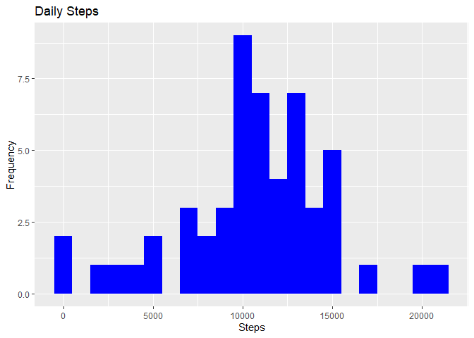
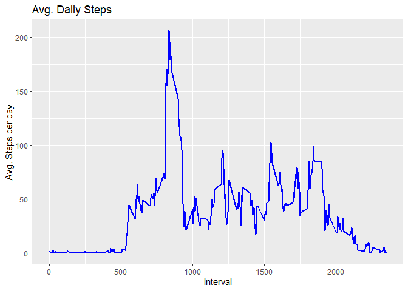
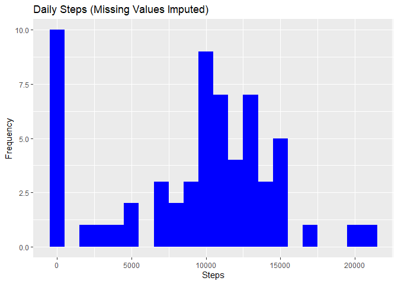
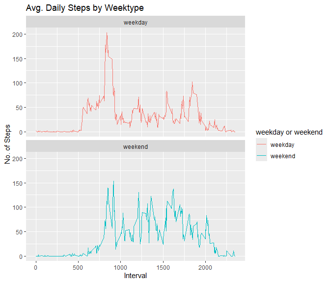

## Loading and preprocessing the data


``` r
library(data.table)
```

```
## Warning: il pacchetto 'data.table' è stato creato con R versione 4.5.3
```

``` r
library(ggplot2)
```

```
## Warning: il pacchetto 'ggplot2' è stato creato con R versione 4.5.3
```

``` r
fileUrl <- "https://d396qusza40orc.cloudfront.net/repdata%2Fdata%2Factivity.zip"
if (!file.exists("data/activity.csv")) {
  download.file(fileUrl, destfile = "activity.zip", mode = "wb")
  unzip("activity.zip", exdir = "data")
}

activityDT <- data.table::fread(input = "data/activity.csv")
```

## What is mean total number of steps taken per day?


``` r
Total_Steps <- activityDT[, c(lapply(.SD, sum, na.rm = FALSE)), .SDcols = c("steps"), by = .(date)]
head(Total_Steps, 10)
```

```
##           date steps
##         <IDat> <int>
##  1: 2012-10-01    NA
##  2: 2012-10-02   126
##  3: 2012-10-03 11352
##  4: 2012-10-04 12116
##  5: 2012-10-05 13294
##  6: 2012-10-06 15420
##  7: 2012-10-07 11015
##  8: 2012-10-08    NA
##  9: 2012-10-09 12811
## 10: 2012-10-10  9900
```


``` r
ggplot(Total_Steps, aes(x = steps)) +
  geom_histogram(fill = "blue", binwidth = 1000) +
  labs(title = "Daily Steps", x = "Steps", y = "Frequency")
```

<!-- -->


``` r
Total_Steps[, .(Mean_Steps = mean(steps, na.rm = TRUE), Median_Steps = median(steps, na.rm = TRUE))]
```

```
##    Mean_Steps Median_Steps
##         <num>        <int>
## 1:   10766.19        10765
```

## What is the average daily activity pattern?


``` r
IntervalDT <- activityDT[, c(lapply(.SD, mean, na.rm = TRUE)), .SDcols = c("steps"), by = .(interval)]

ggplot(IntervalDT, aes(x = interval, y = steps)) +
  geom_line(color = "blue", linewidth = 1) +
  labs(title = "Avg. Daily Steps", x = "Interval", y = "Avg. Steps per day")
```

<!-- -->


``` r
IntervalDT[steps == max(steps), .(max_interval = interval)]
```

```
##    max_interval
##           <int>
## 1:          835
```

## Imputing missing values


``` r
activityDT[is.na(steps), .N]
```

```
## [1] 2304
```

Missing values are filled in with the median number of steps across the whole dataset.


``` r
activityDT[is.na(steps), "steps"] <- activityDT[, c(lapply(.SD, median, na.rm = TRUE)), .SDcols = c("steps")]

data.table::fwrite(x = activityDT, file = "data/tidyData.csv", quote = FALSE)

# total number of steps taken per day
Total_Steps <- activityDT[, c(lapply(.SD, sum)), .SDcols = c("steps"), by = .(date)]

# mean and median total number of steps taken per day
Total_Steps[, .(Mean_Steps = mean(steps), Median_Steps = median(steps))]
```

```
##    Mean_Steps Median_Steps
##         <num>        <int>
## 1:    9354.23        10395
```


``` r
ggplot(Total_Steps, aes(x = steps)) +
  geom_histogram(fill = "blue", binwidth = 1000) +
  labs(title = "Daily Steps (Missing Values Imputed)", x = "Steps", y = "Frequency")
```

<!-- -->

## Are there differences in activity patterns between weekdays and weekends?

Weekends are identified by day number (0 = Sunday, 6 = Saturday) so this works
regardless of the computer's language setting.


``` r
# recreating activityDT from scratch, then making the new factor variable
activityDT <- data.table::fread(input = "data/activity.csv")
activityDT[, date := as.POSIXct(date, format = "%Y-%m-%d")]

activityDT[, `weekday or weekend` := factor(
  ifelse(as.POSIXlt(date)$wday %in% c(0, 6), "weekend", "weekday"),
  levels = c("weekday", "weekend"))]

head(activityDT, 10)
```

```
##     steps       date interval weekday or weekend
##     <int>     <POSc>    <int>             <fctr>
##  1:    NA 2012-10-01        0            weekday
##  2:    NA 2012-10-01        5            weekday
##  3:    NA 2012-10-01       10            weekday
##  4:    NA 2012-10-01       15            weekday
##  5:    NA 2012-10-01       20            weekday
##  6:    NA 2012-10-01       25            weekday
##  7:    NA 2012-10-01       30            weekday
##  8:    NA 2012-10-01       35            weekday
##  9:    NA 2012-10-01       40            weekday
## 10:    NA 2012-10-01       45            weekday
```


``` r
activityDT[is.na(steps), "steps"] <- activityDT[, c(lapply(.SD, median, na.rm = TRUE)), .SDcols = c("steps")]
IntervalDT <- activityDT[, c(lapply(.SD, mean, na.rm = TRUE)), .SDcols = c("steps"), by = .(interval, `weekday or weekend`)]

ggplot(IntervalDT, aes(x = interval, y = steps, color = `weekday or weekend`)) +
  geom_line() +
  labs(title = "Avg. Daily Steps by Weektype", x = "Interval", y = "No. of Steps") +
  facet_wrap(~`weekday or weekend`, ncol = 1, nrow = 2)
```

<!-- -->
